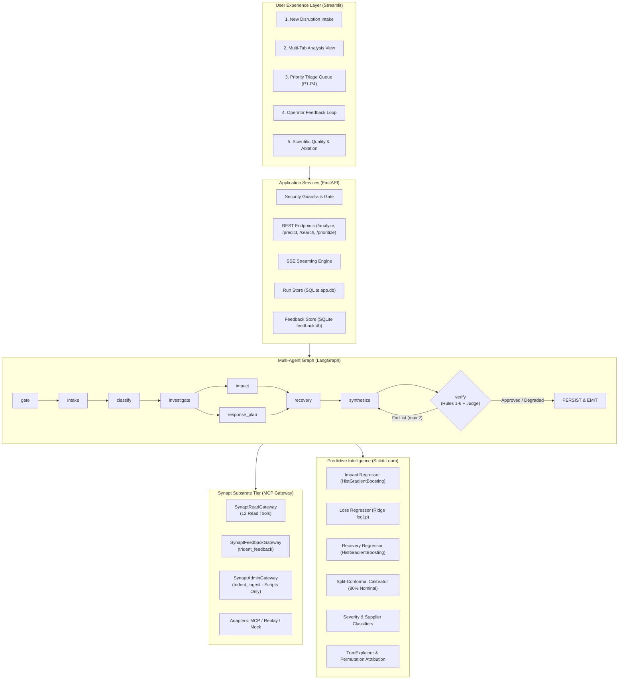
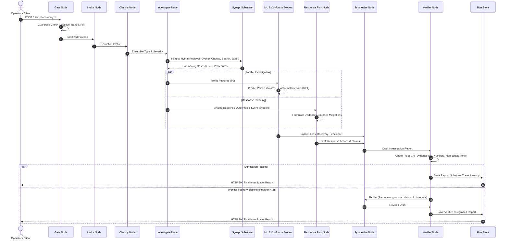
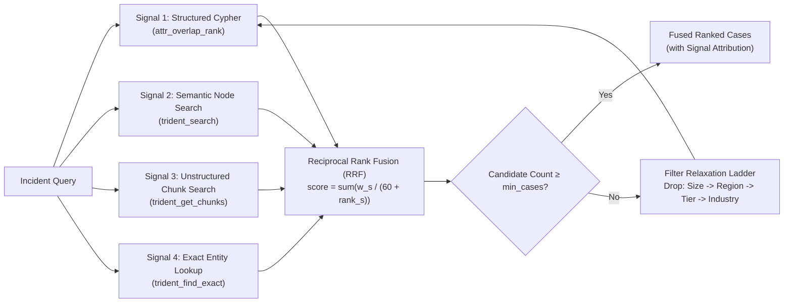
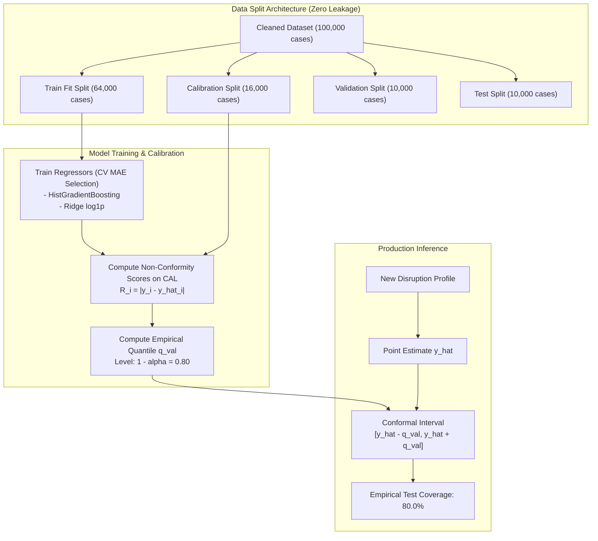

# System Architecture & Technical Specifications

> **System Name:** AI-Powered Supply Chain Disruption Investigation Assistant  
> **Substrate Engine:** Synapt (Trident Knowledge & Graph Engine via Model Context Protocol)  
> **Workflow Orchestration:** LangGraph Multi-Agent StateGraph  
> **Predictive Machine Learning:** Split-Conformal Calibrated HistGradientBoosting & Ridge Regressors  

---

## 1. High-Level Architectural Overview

The Supply Chain Disruption Assistant is an enterprise-grade agentic system designed to triage, investigate, predict, and mitigate operational disruptions across global supply networks. The architecture enforces an uncompromising **Evidence Contract**: no factual claim or mitigation recommendation can be surfaced to the user without direct provenance in the Synapt graph substrate or validated case ledger.

---

## 2. LangGraph Multi-Agent Workflow Sequence

The investigation workflow executes a directed state graph where intermediate nodes produce typed findings into `WorkflowState`. A deterministic verifier inspects all claims before publishing.

---

## 3. Four-Signal Hybrid Retrieval Architecture

To overcome the limitations of isolated text search or rigid graph queries, retrieval executes four distinct signals against Synapt, combined via Reciprocal Rank Fusion (RRF):

---

## 4. Machine Learning & Split-Conformal Calibration Architecture

---

## 5. Security & Permission Boundary Architecture

The architecture enforces a strict privilege boundary across runtime tiers:
1. **User Tier:** Only accesses `SynaptReadGateway` and `SynaptFeedbackGateway`.
2. **Admin Tier (`scripts/ingest_to_synapt.py`):** Holds access to `SynaptAdminGateway` (`trident_ingest`).
3. **Automated Enforcement:** Verified by unit test `test_admin_gateway_import_ban` ensuring no module inside `app/` imports `SynaptAdminGateway`.
